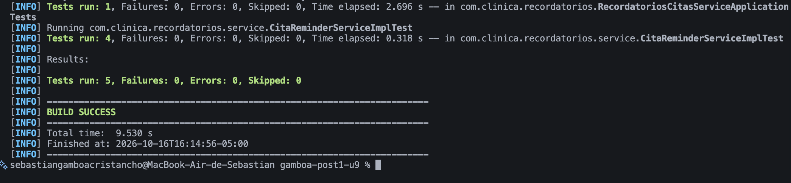
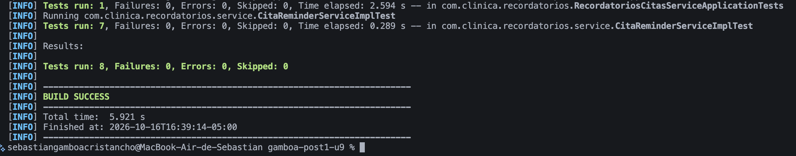
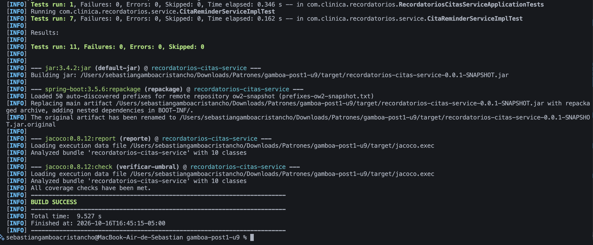
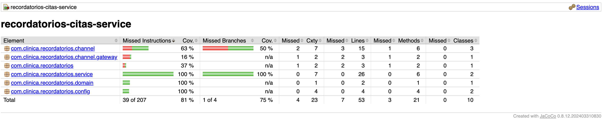
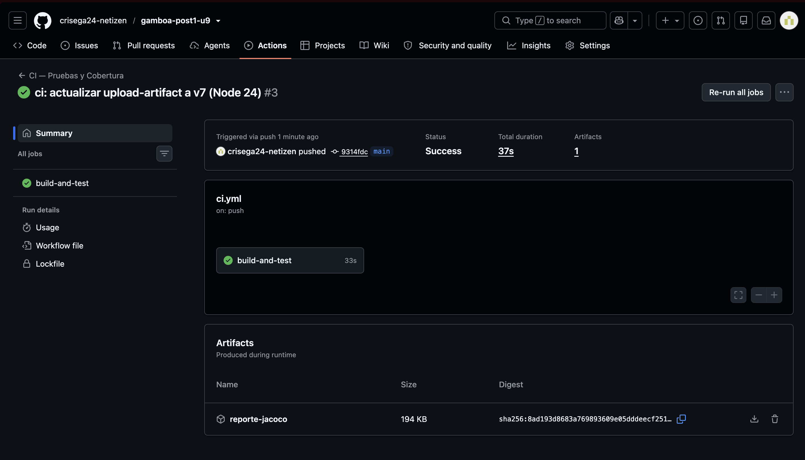
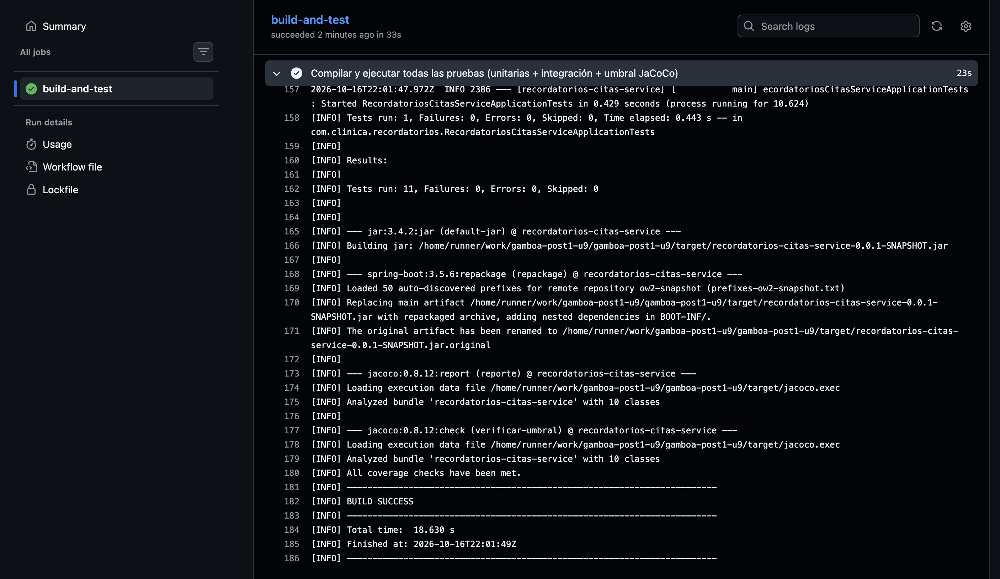

# Recordatorios Citas Service

[](https://github.com/crisega24-netizen/gamboa-post1-u9/actions/workflows/ci.yml)

## Descripción

Repositorio del post-contenido de la Unidad 9. Es un único proyecto Spring Boot que busca las citas médicas de las próximas 24 horas que aún no han sido notificadas y envía un recordatorio por el canal preferido del paciente (correo o SMS). El servicio central, `CitaReminderServiceImpl`, nace diseñado con dos patrones del curso, ambos inyectados por constructor (DIP):

- **Strategy (Unidad 4):** `ReminderChannel`, con las implementaciones intercambiables `EmailReminderChannel` y `SmsReminderChannel`.
- **Factory Method (Unidad 2):** `ReminderChannelFactory`, que entrega la estrategia correcta según el `CanalNotificacion` de la cita.

La Parte 1 prueba ese servicio en aislamiento con JUnit 5 y Mockito. La Parte 2 agrega un recordatorio urgente que nace violando DIP, lo refactoriza para poder probarlo, suma pruebas de integración con H2 y un pipeline de GitHub Actions con umbral de cobertura JaCoCo.

## Estructura del proyecto

```
src/main/java/com/clinica/recordatorios/
├── domain/        Cita (entidad JPA), CanalNotificacion (EMAIL, SMS)
├── repository/    CitaRepository (JpaRepository)
├── channel/       ReminderChannel (Strategy) + Email/Sms + ReminderChannelFactory (Factory)
│   └── gateway/   NotificadorSmsGateway + TwilioNotificadorSmsGateway
├── service/       CitaReminderService, CitaReminderServiceImpl, CitaNoEncontradaException
└── config/        ClockConfig y CanalUrgenteConfig (composition root)
src/test/java/com/clinica/recordatorios/
├── service/       CitaReminderServiceImplTest           (unitarias, Mockito, sin Spring)
├── repository/    CitaRepositoryTest                    (@DataJpaTest con H2)
└── CitaReminderServiceIntegrationTest                   (@SpringBootTest con H2)
.github/workflows/ci.yml                                 (GitHub Actions)
```

## Parte 1 — Pruebas unitarias con JUnit 5 y Mockito

`CitaReminderServiceImplTest` aísla `CitaReminderServiceImpl` de sus colaboradores. El servicio se construye a mano en `@BeforeEach` con los dobles de prueba, sin levantar Spring, y la clase completa corre en menos de medio segundo.

| Prueba | Qué verifica |
|---|---|
| `enviarRecordatoriosPendientes_citaEnVentana_usaElCanalPreferido` | La cita EMAIL se envía por el canal que entrega la Factory, queda marcada como enviada y se guarda una vez |
| `enviarRecordatoriosPendientes_citaConCanalSms_pideALaFactoryElCanalSms` | Con una cita SMS el servicio pide a la Factory el canal SMS y nunca el EMAIL |
| `enviarRecordatoriosPendientes_ventanaDeterministaSegunClockFijo_consultaLosLimitesExactos` | La ventana consultada es exactamente 10/08/2026 09:00 → 11/08/2026 09:00 gracias al Clock fijo |
| `enviarRecordatoriosPendientes_sinCitasPendientes_noConsultaLaFactory` | Sin citas pendientes no se consulta la Factory ni se guarda nada |

## Parte 2 — Refactor DIP, integración y CI/CD

### Diagnóstico antes del refactor (Paso 7)

La primera versión de `enviarRecordatorioUrgente(Long citaId)` (commit `479285d`) compila y funciona, pero no se puede probar en aislamiento. La línea responsable era la 52 de `CitaReminderServiceImpl`:

```java
ReminderChannel canalUrgente = new SmsReminderChannel(new TwilioNotificadorSmsGateway());
```

El método decidía por sí mismo **qué** canal usar y **cómo** construirlo. Como `SmsReminderChannel` y `TwilioNotificadorSmsGateway` se creaban con `new` dentro del cuerpo del método, no existía ningún punto (constructor, parámetro o setter) por donde una prueba pudiera entregar un doble. Por eso era imposible escribir la prueba del escenario «el gateway de SMS falla y la cita no debe quedar marcada como enviada»: la prueba no podía provocar el fallo y terminaba llamando al gateway real. Interceptar ese `new` con `Mockito.mockConstruction()` habría tratado el síntoma con una herramienta más avanzada, cuando el problema era de diseño: el método dependía de clases concretas y no de la abstracción `ReminderChannel` (violaba DIP).

El contraste con `enviarRecordatoriosPendientes()` es directo: ese método nunca construye sus colaboradores, los recibe por constructor (`CitaRepository`, `ReminderChannelFactory` y `Clock`). Por eso en la Parte 1 se pudieron reemplazar por un Mock, otro Mock y un Fake sin tocar el código de producción.

### El refactor (Paso 8): antes y después

| Antes (commit `479285d`) | Después (commit `eefed2e`) |
|---|---|
| El servicio construye el canal dentro del método | El servicio recibe `@Qualifier("canalUrgente") ReminderChannel canalUrgente` por constructor |
| `new SmsReminderChannel(new TwilioNotificadorSmsGateway())` en la lógica de negocio | El único `new` vive en `config/CanalUrgenteConfig.java`, el composition root |
| El servicio importa dos clases concretas de infraestructura | El servicio solo conoce la abstracción `ReminderChannel` |
| La prueba del fallo del gateway es imposible | La prueba existe y pasa en verde |

```java
// config/CanalUrgenteConfig.java — el único lugar donde es correcto escribir "new" para este canal
@Bean
public ReminderChannel canalUrgente(NotificadorSmsGateway gateway) {
    return new SmsReminderChannel(gateway);
}

// service/CitaReminderServiceImpl.java — la lógica ya no construye nada
canalUrgente.enviar(cita, "URGENTE: su cita es en menos de 2 horas y no ha sido confirmada");
```

El comportamiento externo no cambió: las 5 pruebas existentes siguieron en verde en el commit del refactor. Lo que cambió es que ahora el canal se puede sustituir. Las pruebas que eso habilitó (commit `58acee5`):

| Prueba | Qué demuestra |
|---|---|
| `enviarRecordatorioUrgente_citaExistente_usaCanalUrgenteInyectado` | Envía por el canal inyectado un mensaje con «URGENTE», marca y guarda la cita, y no pasa por la Factory |
| **`enviarRecordatorioUrgente_gatewayFalla_noMarcaComoEnviado`** | El mock lanza «Gateway de SMS no disponible»: la excepción se propaga, la cita **no** queda marcada y **no** se llama a `save()`. Esta prueba era imposible antes del refactor |
| `enviarRecordatorioUrgente_citaInexistente_lanzaCitaNoEncontradaException` | Un id inexistente lanza la excepción de dominio sin tocar el canal urgente |

### Pruebas de integración con H2 (Pasos 9 y 10)

| Prueba | Tipo | Qué verifica |
|---|---|---|
| `CitaRepositoryTest.findByFechaHoraCitaBetweenAndRecordatorioEnviadoFalse_soloRetornaCitasPendientesEnVentana` | `@DataJpaTest` | De tres citas (pendiente en ventana, ya enviada, fuera de ventana) la consulta derivada devuelve exactamente una: valida el SQL real que genera Spring Data |
| `CitaReminderServiceIntegrationTest.enviarRecordatoriosPendientes_contextoCompletoDeSpring_persisteYNotificaCitasEnVentana` | `@SpringBootTest` | Con el contexto completo, la cita SMS en ventana se notifica a través del gateway y queda persistida como enviada |
| `CitaReminderServiceIntegrationTest.enviarRecordatorioUrgente_contextoCompletoDeSpring_usaElCanalUrgenteDeCanalUrgenteConfig` | `@SpringBootTest` | El bean de `CanalUrgenteConfig` queda bien conectado: aunque la cita prefiera EMAIL, el urgente sale por SMS |

### Pipeline de CI (Paso 11)

`.github/workflows/ci.yml` se ejecuta en cada push y pull request a `main`: checkout, JDK 21 (Temurin) con caché de Maven y `mvn -B verify`, que corre las 11 pruebas, genera el reporte JaCoCo y **falla el build si la cobertura de líneas baja del 80 %**. El reporte se publica como artefacto descargable (`reporte-jacoco`) en cada ejecución. El workflow no necesita un bloque `services:` con una base de datos real porque todas las pruebas de integración usan H2 en memoria.

## Decisiones de diseño

### Por qué Strategy facilitó las pruebas

Sin `ReminderChannel` como interfaz, la lógica de envío (SMTP o SMS) estaría escrita en línea dentro del servicio, y probar el envío exigiría mockear librerías de bajo nivel (cliente SMTP, cliente HTTP del proveedor) o enviar mensajes reales. Con Strategy, un solo `@Mock ReminderChannel` con un único método `enviar()` sirve para verificar **cualquier** canal: `verify(reminderChannelMock).enviar(eq(cita), anyString())` comprueba que la cita salió por el canal elegido sin que exista un servidor de correo ni un proveedor de SMS. La misma abstracción es la que permitió en la Parte 2 sustituir el canal urgente y simular su fallo con `doThrow`.

### Por qué Factory Method facilitó las pruebas

Sin `ReminderChannelFactory`, el servicio tendría un `if/else` o un `switch` embebido para decidir el canal, y esa decisión solo sería observable de forma indirecta (revisando qué se imprimió o qué se envió realmente). Con la Factory inyectada, la selección de canal se convierte en una interacción explícita y verificable: `verify(reminderChannelFactory).obtenerCanal(CanalNotificacion.SMS)` y `verify(reminderChannelFactory, never()).obtenerCanal(CanalNotificacion.EMAIL)`. También permite probar el caso vacío con `verifyNoInteractions(reminderChannelFactory)`.

### Mock, Stub o Fake para cada colaborador (Paso 5)

| Colaborador | Test Double | Justificación |
|---|---|---|
| `CitaRepository` | **Mock** | No basta con que `findByFechaHoraCitaBetweenAndRecordatorioEnviadoFalse` devuelva una lista (eso sería un Stub): la prueba también debe comprobar que `save()` se llama exactamente una vez con la cita ya marcada como enviada, que no se llama cuando no hay citas y que no se llama cuando el gateway falla. Cuando se necesita controlar la respuesta **y** verificar la interacción, el doble es un Mock. |
| `ReminderChannelFactory` / `ReminderChannel` | **Mock** | El comportamiento bajo prueba es justamente la selección de la estrategia: que el servicio pida el canal que corresponde al `canalPreferido` y que ese canal reciba el mensaje. Ese resultado no es un valor de retorno del servicio; solo se observa verificando la interacción. |
| `Clock` | **Fake** (no Mock) | `Clock.fixed(...)` es una implementación real y completa de `java.time.Clock` que trae el propio JDK, con el instante congelado. Mockear `Clock` obligaría a stubbear `instant()` y `getZone()` por separado y arriesgar que `LocalDateTime.now(clock)` no se comporte como un reloj real. El Fake es más simple, más legible y fiel a producción, y hace que la ventana de 24 horas sea exacta y repetible en cualquier máquina y a cualquier hora. |

### El refactor DIP

`enviarRecordatorioUrgente()` no se pudo probar mientras construía `SmsReminderChannel` con `new` dentro del método. Moverlo al bean `canalUrgente()` de `CanalUrgenteConfig` e inyectar `ReminderChannel` por constructor lo hizo testeable sin cambiar su comportamiento externo. La prueba `enviarRecordatorioUrgente_gatewayFalla_noMarcaComoEnviado` es la evidencia de que la testabilidad es una consecuencia directa de aplicar DIP, no de usar una herramienta de pruebas más poderosa. El paquete `config/` concentra ahora toda la construcción de dependencias concretas (`ClockConfig`, `CanalUrgenteConfig`) y deja la lógica de negocio libre de `new`.

### Por qué H2 real pero gateway mockeado

En `CitaReminderServiceIntegrationTest` conviven una base de datos real (H2 en memoria) y un `@MockBean` sobre `NotificadorSmsGateway`. No es inconsistente: H2 es un Fake aceptable porque su contrato SQL/JPA es equivalente al de la base real y no requiere infraestructura. Un proveedor de SMS de terceros no tiene un equivalente gratuito y determinista; reemplazarlo con un Mock evita depender de credenciales, de red y de la disponibilidad del proveedor en cada ejecución del pipeline. El `Clock` también se reemplaza por `Clock.fixed(...)` para que la ventana de 24 horas sea determinista con el contexto completo.

## Cobertura (JaCoCo)

| Métrica | Cobertura |
|---|---|
| Instrucciones | 81 % |
| Líneas (umbral exigido ≥ 80 %) | 86,8 % (46/53) |
| Métodos | 85,7 % |
| `CitaReminderServiceImpl` | 100 % de líneas y ramas |

Las líneas no cubiertas son las simulaciones de `EmailReminderChannel` y `TwilioNotificadorSmsGateway` (en todas las pruebas se reemplazan por dobles, a propósito), el `main()` de la aplicación y la rama EMAIL de la Factory en el contexto completo. `lombok.config` marca el código generado por Lombok para que JaCoCo no lo cuente.

## Ajustes respecto a la guía

1. **Spring Boot 3.5.6 con JDK 21:** Spring Initializr ya no ofrece la línea 3.3.x; se fijó la última 3.x estable y se usó el JDK 21 que exige la guía y el pipeline.
2. **JaCoCo agregado al `pom.xml`:** la guía lo nombra pero ningún paso lo configura. Se agregaron `prepare-agent`, `report` y `check` con umbral de 80 % de líneas.
3. **Bean de reloj de prueba renombrado a `clockFijo()`:** con el nombre `clock()` de la guía, el contexto de `@SpringBootTest` no arranca porque Spring Boot no permite dos beans con el mismo nombre. Con `@Primary` gana sobre el de `ClockConfig`.
4. **El commit del Paso 7 incluye `CitaReminderServiceImpl.java`:** así el `new` hardcodeado queda en el historial y el antes/después del refactor es verificable.
5. **El commit del refactor incluye el ajuste del `@BeforeEach`:** el nuevo constructor rompería la compilación de las pruebas existentes; cada commit compila y pasa sus pruebas.
6. **`@MockBean`** se mantuvo porque la actividad lo exige; está deprecado desde Boot 3.4 (su reemplazo es `@MockitoBean`), por eso lleva `@SuppressWarnings("removal")`.
7. **Acciones de GitHub actualizadas** (`checkout@v5`, `setup-java@v5`, `upload-artifact@v7`) y runner fijo `ubuntu-24.04`: las versiones v4 de la guía generaban advertencias de Node.js 20 deprecado.
8. **Pruebas adicionales:** selección del canal SMS en la Parte 1, `assertFalse` sobre la cita en la prueba del fallo del gateway y la prueba integrada del canal urgente.

## Ejecutar las pruebas

Requiere JDK 21 (o usar el wrapper incluido con Maven 3.9+).

```bash
./mvnw test      # pruebas unitarias e integración
./mvnw verify    # todo lo anterior + reporte JaCoCo y verificación del umbral de cobertura
open target/site/jacoco/index.html   # reporte de cobertura (macOS)
```

## Evidencia

| # | Descripción | Captura |
|---|---|---|
| 01 | Parte 1: 4 pruebas unitarias + `contextLoads` en verde |  |
| 02 | Parte 2: 7 pruebas de `CitaReminderServiceImplTest` tras el refactor DIP |  |
| 03 | `@DataJpaTest` y `@SpringBootTest` en verde: 11 pruebas, BUILD SUCCESS |  |
| 04 | Reporte de cobertura JaCoCo |  |
| 05 | Workflow de GitHub Actions con estado Success y sin advertencias |  |
| 06 | Log del job: 11 pruebas, umbral de cobertura cumplido y BUILD SUCCESS |  |

## Herramientas utilizadas

- Java 21 (Eclipse Temurin), Spring Boot 3.5.6, Spring Data JPA, H2, Lombok
- JUnit 5, Mockito, Spring Boot Test (`@DataJpaTest`, `@SpringBootTest`), JaCoCo 0.8.12
- Apache Maven (wrapper), GitHub Actions, Git y GitHub

## Conclusiones

La testabilidad de una clase se decide cuando se diseña, no cuando se escribe la prueba: `enviarRecordatoriosPendientes()` se pudo probar desde el primer día porque recibía sus colaboradores por constructor, mientras que `enviarRecordatorioUrgente()` fue imposible de probar hasta que su `new` se movió al composition root. Strategy y Factory Method no solo organizan el código de producción; convierten la selección y el uso del canal en interacciones verificables con un único mock. Elegir el Test Double según lo que se necesita verificar (Mock para el repositorio y los canales, Fake para el reloj) produjo pruebas rápidas, deterministas y sin infraestructura. Finalmente, las pruebas con H2 y el pipeline con umbral de cobertura cierran el ciclo: lo que se prueba en local se verifica automáticamente en cada push, sin necesidad de una base de datos ni de un proveedor de SMS reales.
